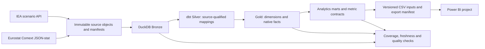

# Global Critical Materials

A reproducible analytics product for comparing global mining/refining concentration, European trade exposure and critical-material demand scenarios. The report covers six material groups and trade exposure for Germany, France, Italy, Spain, Poland, the Netherlands and the official EU27 external-trade aggregate.

**[Explore the interactive Power BI report](https://app.powerbi.com/view?r=eyJrIjoiYWM2MzI5NjMtOGUzNi00ZDI1LThkMzYtOGUwNTU3NWJmMjI1IiwidCI6IjM5YTFiNjM3LTFmODktNGQzOS1iZjNlLWFiNzczZGRmOGJhZSJ9)**

**Stack:** Python · SQL · DuckDB · dbt Core · Power BI · GitHub Actions.

## Business questions

- Where are mining and refining concentrated, and how do the two stages differ?
- Which reported partners supply a selected European market and product?
- Does supplier concentration change between trade value and product mass?
- How does native-scope demand differ across CPS, STEPS and HDS scenarios?
- Which indicators can the data support, and which inputs are still missing?

## Report

| Page | Decision supported |
|---|---|
| Global Supply Landscape | Compare country shares, concentration bounds and expected mining/refining output |
| European Trade & Dependency | Compare source-scoped imports/exports, balances and partner exposure |
| Supply Chain Risk | Inspect mining/refining and supplier concentration separately |
| Future Outlook | Compare demand scenarios, end uses and STEPS expected output |

Six material tiles connect supply, trade, concentration and demand analysis. Native material definitions, traded product forms and scenario assumptions remain explicit throughout the report.

### Global Supply Landscape

**Filters:** Copper · Supply year 2025 · IEA STEPS / Base Case. Country shares have separate mining/refining denominators and include the undisclosed Other countries group.

Explore the other three report pages

### European Trade & Dependency

**Filters:** Graphite (natural powder/flakes, CN8 25041000) · Germany · 2024 · Value EUR.

### Supply Chain Risk

**Filters:** All materials · Supply year 2025 · Reporting area Germany · Trade year 2024. The scatter and bars use physical-output HHI; the table compares import-value and product-mass HHI.

### Future Outlook

**Filters:** Nickel · Outlook year 2035 · CPS/STEPS/HDS shown together. All grades is Off and affects only graphite.

These are actual Power BI screenshots supplied on 4 November 2026. The source capture is 30 October–1 November 2026; the 2025 IEA baseline is not certified here as observed actuals. [Screenshot contexts](dashboards/screenshots/README.md).

## What the data shows

- **The relevant supply-chain stage changes by material.** In the 2025 baseline, lithium refining HHI is 0.573 versus 0.214 for mining; nickel reverses the pattern, at 0.304 versus 0.412. These are lower bounds; the stage intervals do not overlap.
- **Mining geography does not describe refining geography.** Chile accounts for 23.6% of the copper mining panel but 6.2% of refining; China accounts for 7.9% and 46.8%, respectively.
- **The measurement basis can change a sourcing comparison.** German imports of natural graphite powder/flakes have lower supplier HHI than copper ores by EUR value (0.166 vs 0.189), but higher HHI by product mass (0.199 vs 0.188), in 2024.
- **Nickel demand depends on both the scenario and the end-use mix.** Returned 2035 demand totals range from 4,993.1 kt in CPS to 5,766.2 kt in HDS. In STEPS, Other uses accounts for 61.5% of the returned total; electric vehicles account for 29.0%.

[Eight evidence-based findings](docs/business_insights/findings.md) include the business implications, exact page/filter settings, supporting screenshots and [reproducible SQL](docs/business_insights/findings.sql). Results apply to the included capture and native definitions; they are not claims about every material or product.

## Architecture

Facts retain their native grain: demand by exact definition/scenario/end use/year, supply by exact definition/stage/country/year, trade by reporter/partner/annual CN8/flow. Snapshot keys preserve lineage. Mining and refining are never added; demand detail and returned-end-use totals are never double-counted.

See [model grains](docs/architecture/model_grains.md), [metric formulas](docs/methodology/metrics.md) and the [data dictionary](docs/data_dictionary/warehouse_columns.md).

## Data coverage

| Source | Included scope | Source capture |
|---|---|---|
| IEA Critical Minerals Dataset, GCMO2026 | 7 exact definitions; demand 2025–2050 / 3 scenarios; expected supply 2025–2040 / STEPS | 30 October 2026 |
| Eurostat Comext DS-045409 | 6 national reporters + EU27_2020; 6 native CN8 forms; 2018–2024, with magnet observations only 2023–2024 | 30 October–1 November 2026 |

The report inputs contain 558 native demand rows, 448 native supply rows and 16,964 native trade rows before presentation projections. National trade denominators include intra-EU partners; EU27 uses the native external-partner total with fixed 2020 membership. The bloc must not be added to individual countries.

[Source inventory](docs/sources/inventory.md) · [Licensing and attribution](docs/sources/licensing.md).

## Reproduce the project

[Setup and reproduction guide](docs/getting_started.md): open the Power BI source project, rebuild the analytical pipeline, reproduce findings and run offline checks. Detailed operations: [Power BI](docs/operations/powerbi.md) · [warehouse](docs/operations/warehouse.md).

## Quality and limitations

Current local checks: **36 dbt models, 256 dbt tests and 31 Python tests**. All **637,211 exported scalar fields** were checked against DuckDB; 1,013 partner-scope totals were reconciled after display grouping. Check [validation results](docs/validation/) and hosted Actions for their respective execution status. Schema checks do not execute DAX.

- IEA expected output is not installed capacity. The 2025 baseline is not certified here as observed actuals.
- Trade product mass is not contained-metal mass; reported partner is not necessarily mine origin.
- Annual CN8 continuity is unverified. Same-code trends and composition diagnostics remain conditional.
- German cobalt mass has an unresolved external-reconciliation caveat.
- Opaque supply residuals support HHI bounds, not exact global producer ranks.
- Consumption-based import dependency, matched physical supply-demand gaps and capacity growth are unavailable; no synthetic values or combined risk score are produced.
- Data are a fixed capture, not a live market feed. Freshness is assessed from original acquisition timestamps.

## Attribution

Project code: [MIT](LICENSE). Source data, references and fonts retain their own rights; see [NOTICE](NOTICE.md). Analysis by **Anastasia Klein**.

Derived from IEA material by Anastasia Klein, who accepts sole responsibility and liability for this work. Neither the IEA nor its Member countries endorses the analysis. Modified Eurostat results are the author's responsibility, not Eurostat's.
