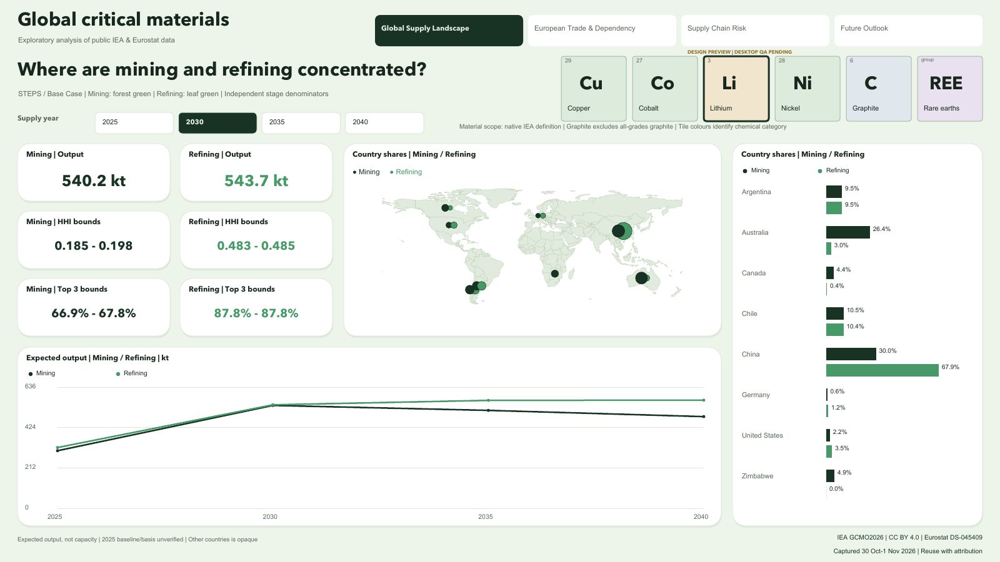
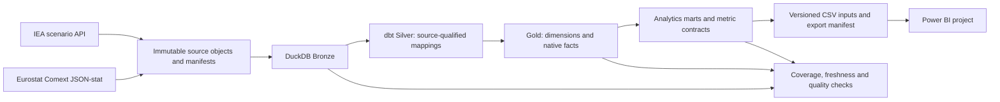

# Global Critical Materials Intelligence

A reproducible analytics product for comparing global mining/refining concentration, European trade exposure and critical-material demand scenarios. Germany is the main analytical lens; the report also supports France, Italy, Spain, Poland, the Netherlands and the official EU27 external-trade aggregate.

**[Explore the interactive Power BI report](https://app.powerbi.com/view?r=eyJrIjoiYWM2MzI5NjMtOGUzNi00ZDI1LThkMzYtOGUwNTU3NWJmMjI1IiwidCI6IjM5YTFiNjM3LTFmODktNGQzOS1iZjNlLWFiNzczZGRmOGJhZSJ9)**

**Stack:** Python · SQL · DuckDB · dbt Core · Power BI · GitHub Actions.

## Business questions

- Where are mining and refining concentrated, and how do the two stages differ?
- Which reported partners supply a selected European market and product?
- Does supplier concentration change between trade value and product mass?
- How does native-scope demand differ across CPS, STEPS and HDS scenarios?
- Which indicators can the data support, and which inputs are still missing?

## Report

| Page | Decision supported |
|---|---|
| Global Supply Landscape | Compare country shares, concentration bounds and expected mining/refining output |
| European Trade & Dependency | Compare source-scoped imports/exports, balances and partner exposure |
| Supply Chain Risk | Inspect mining/refining and supplier concentration separately |
| Future Outlook | Compare demand scenarios, end uses and STEPS expected output |

Six periodic material tiles select Cu, Co, Li, Ni, C or REE. Traded CN8 forms remain distinct from IEA material definitions. Fixed partner/end-use axes make selections easier to compare. Three scenario colours are shared by all outlook KPI values, lines and end-use bars; scenario alternatives are not stacked into a sum. Reported zeros stay zero; missing source observations are not filled with zero.



The image is a **SQL-derived design preview**. Use the interactive report above to explore the published Power BI visuals. [Report setup and validation](docs/operations/powerbi.md) explain how to reproduce the report locally.

## Selected findings

These statements apply to the included source capture and exact definitions, not to all historical supply or all products:

- **Refining is more concentrated than mining for lithium:** 2030 STEPS lower-bound HHI is 0.483 versus 0.185.
- **Graphite refining has particularly high concentration:** its 2030 lower-bound HHI is 0.815, versus 0.348 for mining.
- **Nickel has the opposite stage pattern:** 2030 mining lower-bound HHI is 0.499, versus 0.325 for refining.
- **Germany's lithium-carbonate imports are led by Chile:** 40.6% of 2024 reported import value; Belgium and the United States account for 26.8% and 24.6%.
- **Electric vehicles dominate the returned lithium end-use total:** 765.3 kt of 932.5 kt in STEPS 2040, approximately 82.1%.

[Reproducible queries and interpretation](docs/business_insights/findings.md) retain the material/year/scenario/basis boundaries.

## Architecture



Facts retain their native grain: demand by exact definition/scenario/end use/year, supply by exact definition/stage/country/year, trade by reporter/partner/annual CN8/flow. Snapshot keys preserve lineage. Mining and refining are never added; demand detail and returned-end-use totals are never double-counted.

See [model grains](docs/architecture/model_grains.md), [metric formulas](docs/methodology/metrics.md) and the [data dictionary](docs/data_dictionary/warehouse_columns.md).

## Data coverage

| Source | Included scope | Source capture |
|---|---|---|
| IEA Critical Minerals Dataset, GCMO2026 | 7 exact definitions; demand 2025–2050 / 3 scenarios; expected supply 2025–2040 / STEPS | 30 October 2026 |
| Eurostat Comext DS-045409 | 6 national reporters + EU27_2020; 6 native CN8 forms; 2018–2024, with magnet observations only 2023–2024 | 30 October–1 November 2026 |

The report inputs contain 558 native demand rows, 448 native supply rows and 16,964 native trade rows before presentation projections. National trade denominators include intra-EU partners; EU27 uses the native external-partner total with fixed 2020 membership. The bloc must not be added to individual countries.

[Source inventory](docs/sources/inventory.md) · [Licensing and attribution](docs/sources/licensing.md).

## Open the Power BI source project

The repository includes the text-based Power BI project, report inputs and data manifest. To edit it, use Power BI Desktop on Windows; the published report can be viewed in a browser.

```powershell
git clone https://github.com/anastasia-klein/global-critical-materials-intelligence.git
cd global-critical-materials-intelligence
powershell -NoProfile -ExecutionPolicy Bypass -File .\scripts\Update-PowerBI.ps1
```

The script checks the report inputs, configures local file paths and opens the project. Select **Refresh** to load the included CSVs. See [report setup](docs/operations/powerbi.md) for update and validation instructions.

## Reproduce the analytical pipeline

Use Python 3.12:

```sh
python3.12 -m venv .venv
source .venv/bin/activate
python -m pip install -r requirements-warehouse.lock.txt
python -m ingestion plan
python -m ingestion run --data-root data/raw
python scripts/build_warehouse.py --data-root data/raw
python scripts/export_powerbi.py --database data/warehouse/gcm.duckdb --output dashboards/powerbi/data
python scripts/build_powerbi.py
```

Live APIs can revise their data. The committed report CSVs and fingerprints preserve the distributed report capture; fetching sources again is a new capture, not a guarantee of identical historical bytes. Full raw archives and database files are not in Git. [Warehouse operations](docs/operations/warehouse.md) explain replay, incremental re-fetch, source-contract checks and historical snapshots.

For offline CI using actual bounded source fixtures:

```sh
python -B -m unittest discover -s tests -v
python scripts/create_ci_capture.py --output work/ci
python scripts/build_warehouse.py --data-root work/ci/capture --config work/ci/fixture_config.json --database work/ci/ci.duckdb --output work/ci/evidence --historical-snapshot
python scripts/validate_business_metrics.py --database work/ci/ci.duckdb --output work/ci/evidence/metrics.json
```

CI also checks deliberate business-rule failures, portable Power BI exports, and the Windows update script. It uses disposable outputs under `work/` and does not refresh the committed report data from live APIs.

## Quality and limitations

Current local checks: **36 dbt models, 256 dbt tests and 31 Python tests**. All **637,211 exported scalar fields** were checked against DuckDB; 1,013 partner-scope totals were reconciled after display grouping. Check [validation results](docs/validation/) and hosted Actions for their respective execution status. Schema checks do not execute DAX.

- IEA expected output is not installed capacity. The 2025 baseline is not certified here as observed actuals.
- Trade product mass is not contained-metal mass; reported partner is not necessarily mine origin.
- Annual CN8 continuity is unverified. Same-code trends and composition diagnostics remain conditional.
- German cobalt mass has an unresolved external-reconciliation caveat.
- Opaque supply residuals support HHI bounds, not exact global producer ranks.
- Consumption-based import dependency, matched physical supply-demand gaps and capacity growth are unavailable; no synthetic values or combined risk score are produced.
- Data are a fixed capture, not a live market feed. Freshness is assessed from original acquisition timestamps.

## Attribution

Project code: [MIT](LICENSE). Source data, references and fonts retain their own rights; see [NOTICE](NOTICE.md). Analysis by **Anastasia Klein**.

Derived from IEA material by Anastasia Klein, who accepts sole responsibility and liability for this work. Neither the IEA nor its Member countries endorses the analysis. Modified Eurostat results are the author's responsibility, not Eurostat's.
