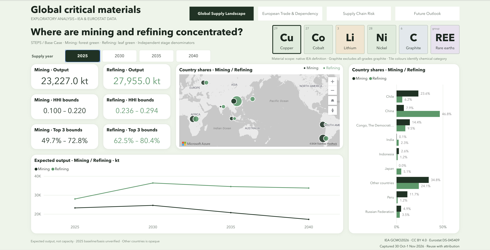
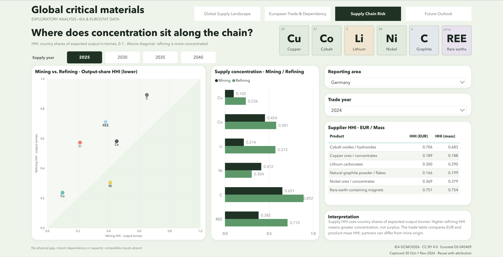
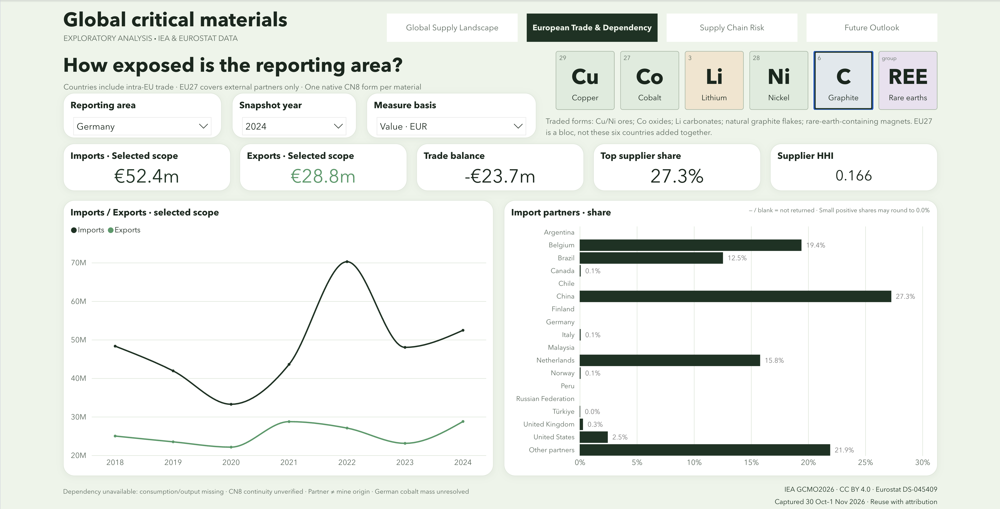
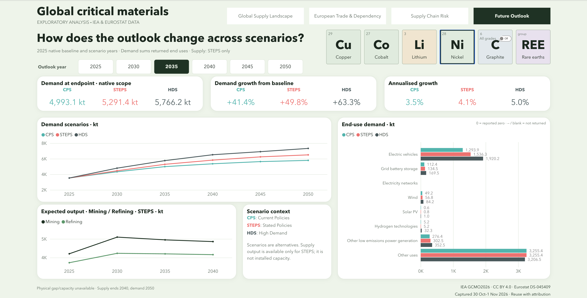

# Findings from the published report capture

Eight findings connect the observed patterns to sourcing and planning questions. Each is reproducible from the committed inputs with `python scripts/run_findings.py`; no live API request or full warehouse is needed. [SQL](findings.sql) · [query results](../validation/findings_results.json) · [setup](../getting_started.md).

The screenshots below are actual Power BI captures supplied on 4 November 2026. Filters are recorded explicitly; source capture dates are 30 October–1 November 2026. Expected-output panels use the IEA STEPS / Base Case. The native 2025 baseline is not independently certified as observed actuals.

## 1. Copper mining and refining have different geographies

**Evidence:** In the 2025 copper panel, Chile accounts for **23.6% of mining** but **6.2% of refining**. China accounts for **7.9% of mining** and **46.8% of refining**.

**Why it matters:** Selecting a mining location does not establish where processing will take place. A sourcing review should investigate both stages and the connections between them.

**Where to look:** Global Supply Landscape → **Cu / Copper** → **Supply year 2025** → Country shares bar chart. Mining is forest green; refining is leaf green. Each stage has its own denominator. These shares do not establish bilateral mine-to-refinery flows or corporate ownership.

**Query:** `copper_stage_country_shares`.

## 2–4. The more concentrated stage changes by material

**Where to look:** Supply Chain Risk → **Supply year 2025** → **clear material selection** to display all six groups. The paired bars and scatter show physical-output HHI lower bounds on a 0–1 scale. The screenshot also uses Germany / trade year 2024 for the separate supplier table; these trade filters do not change the supply HHI.

| Finding | Mining HHI interval | Refining HHI interval | Practical question |
|---|---|---|---|
| **2. Lithium refining is more concentrated than mining** | 0.214–0.219 | 0.573–0.573 | Would new mining suppliers still rely on the same processing countries? |
| **3. Graphite refining has the largest lower-bound HHI of the six displayed refining panels** | 0.651–0.656 | 0.892–0.893 | How could alternatives address concentration at both stages, especially refining? |
| **4. Nickel reverses the lithium pattern** | 0.412–0.419 | 0.304–0.315 | Does a diverse set of processors still depend on concentrated upstream sources? |

The mining/refining intervals do not overlap for these three materials, so the stage ordering holds across the documented residual bounds. The apparent equal lithium refining endpoints are a rounding effect, not proof of zero uncertainty.

Above the scatter's equality diagonal, refining is more concentrated; below it, mining is more concentrated. The diagonal does not measure a physical shortage or surplus. Lower geographic concentration can support diversification, but HHI alone does not assess political risk, substitutability, environmental performance or the reliability of individual suppliers. These are priorities for further investigation, not investment recommendations.

**Query:** `material_stage_concentration` returns both bounds for all six displayed material groups; Graphite: all grades is excluded.

## 5. Germany's graphite trade involves several reported partners

**Evidence:** For natural graphite powder/flakes, Germany reports **€52.4m imports**, **€28.8m exports** and a **−€23.7m trade balance** in 2024. Import-value shares are **China 27.3%**, **Belgium 19.4%**, **Netherlands 15.8%** and **Brazil 12.5%**.

**Why it matters:** The trading-partner view raises different questions from the global refining view. It can help procurement investigate supply channels, but it does not identify mine origin or prove that processing dependencies have been diversified. A negative trade balance is not a consumption-based import-dependency ratio.

**Where to look:** European Trade & Dependency → **C / Graphite** → **Germany** → **Snapshot year 2024** → **Value EUR**. Read the import/export/balance cards and fixed-order Import partners bars. The exact product is **CN8 25041000**, natural graphite powder/flakes; this is not synthetic graphite, all graphite trade or a matched comparison with the IEA refining definition. National totals include intra-EU partners.

**Queries:** `german_graphite_trade`, `german_graphite_suppliers`.

## 6. A supplier-concentration ranking can reverse between value and mass

**Evidence:** For Germany in 2024, supplier HHI is:

| Traded product | EUR-value HHI | Product-mass HHI |
|---|---:|---:|
| Copper ores / concentrates, CN8 26030000 | 0.189 | 0.188 |
| Natural graphite powder / flakes, CN8 25041000 | 0.166 | 0.199 |

Graphite is less concentrated than copper ores by import value, but more concentrated by product mass.

**Why it matters:** Financial exposure and physical sourcing concentration can point to different priorities. Report the basis explicitly instead of presenting one unqualified supplier-concentration ranking. Product mass is not contained-metal mass, and price/product differences can affect value shares; the results do not isolate the cause of the reversal.

**Where to look:** The **Supplier HHI · EUR / Mass** table in the risk screenshot above → **Germany / Trade year 2024**. Supply year 2025 controls the scatter/bars, not this table.

**Query:** `german_concentration_by_basis`. Lower and upper trade HHI bounds coincide for these two slices.

## 7. Nickel demand varies materially across scenarios

**Evidence:** Returned nickel demand at the 2035 endpoint is:

| Scenario | Demand | Growth from the native 2025 baseline |
|---|---:|---:|
| CPS | 4,993.1 kt | +41.4% |
| STEPS | 5,291.4 kt | +49.8% |
| HDS | 5,766.2 kt | +63.3% |

**Why it matters:** Planning against one demand number hides a meaningful range of assumptions. These are alternative IEA scenarios, not probabilities or additive demand components. The report does not derive a matched physical supply-demand gap by subtracting the supply lines from these totals.

**Where to look:** Future Outlook → **Ni / Nickel** → **Outlook year 2035**. The screenshot has **All grades Off**, which does not affect nickel. Read the endpoint and growth cards; colours are CPS turquoise, STEPS coral and HDS slate. The line chart retains the full timeline; endpoint filters control KPI/end-use values.

**Query:** `nickel_demand_scenarios`.

## 8. EVs are important to nickel demand, but the larger category is Other uses

**Evidence:** In STEPS 2035, **Other uses is 3,255.4 kt, or 61.5%**, of the 5,291.4 kt returned end-use total. **Electric vehicles is 1,536.3 kt, or 29.0%**.

**Why it matters:** An EV-only narrative would miss the largest category in this nickel series. Demand analysis needs to retain the wider end-use mix. The source's Other uses category is not disaggregated here, so it cannot be assigned to named industries from this capture alone.

**Where to look:** The **End-use demand** bars and **STEPS endpoint card** in the same Future Outlook screenshot → **Nickel / 2035**. The coral bars represent STEPS. Percentages are derived by the query; the visual displays the quantities in kt. Other uses remains a source category, not a missing-data placeholder.

**Query:** `nickel_end_use_mix`.

## Interpretation boundaries

- Supply shares use each captured named-country-plus-residual panel, not an independently reconciled global production census. Other countries remains opaque; it supports concentration bounds rather than exact country rankings.
- HHI uses squared shares. Supply HHI uses native-scope physical-output tonnes; trade HHI uses reported import value or product mass. These denominators are not interchangeable.
- Trade reporters identify partners, not upstream mine origin. Annual CN8 continuity remains unverified; the single-year trade findings avoid asserting a harmonised long-term commodity series.
- Demand totals are sums of returned end uses. Missing observations remain missing; Graphite and Graphite: all grades are distinct definitions.
- The screenshots verify the illustrated selections, not every possible filter combination. After changes, reconcile visuals using the [Power BI validation checklist](../operations/powerbi.md).
